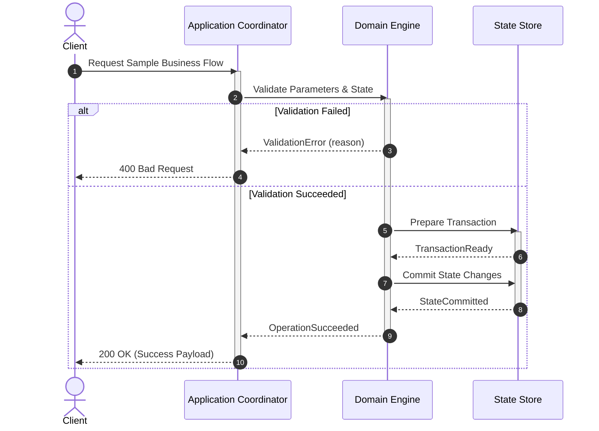
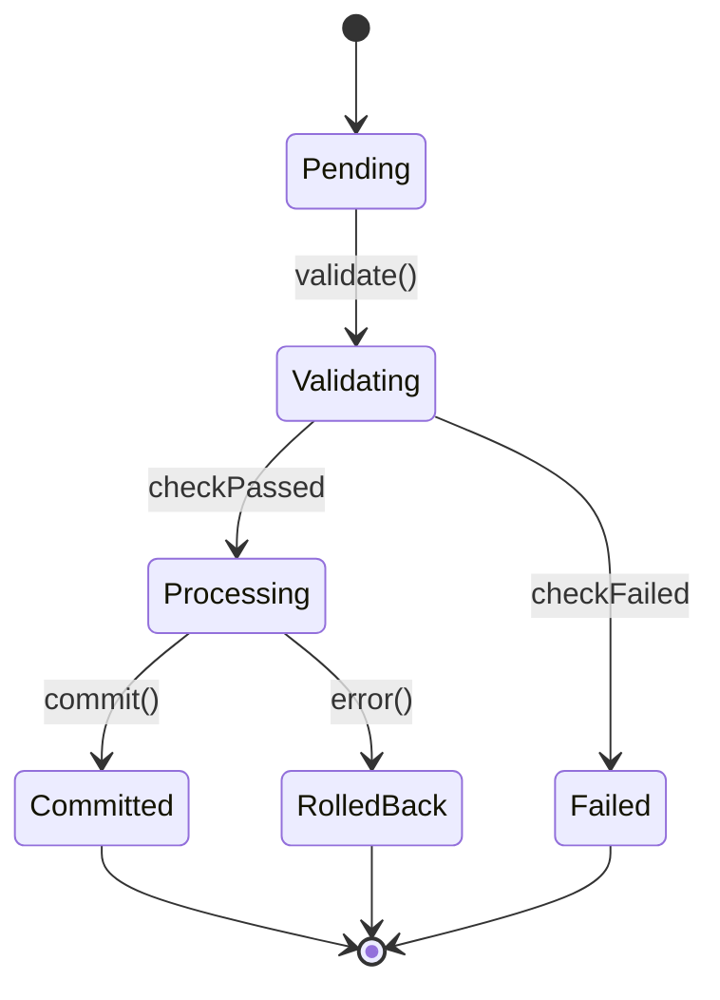

# Domain Flow: Sample Business Flow

> **ALWAYS BE DETERMINISTIC. Human approval resolves every decision.**

- **Flow Identifier:** `sample_flow`
- **Typology:** Core Business Transaction
- **Primary Actors:** Client, Application Coordinator, Storage Service

## 1. Flow Preconditions & Invariants

1. Precondition: Initial state is verified and caller is authorized.
2. Invariant: All mutations are idempotent or transactional; failure triggers immediate rollback.

## 2. Sequence Diagram

## 3. Entity State Transitions

## 4. Failure Modes & Compensation

| Failure Scenario | Detection Point | Automated Recovery / Compensation | User Action Required |
|---|---|---|---|
| Invalid Input | Coordinator validation step | Immediate fail-safe refusal; error message | Correct parameters and retry |
| Storage Collision | State store commit | Transaction rollback; lock release | Retry with backoff |
