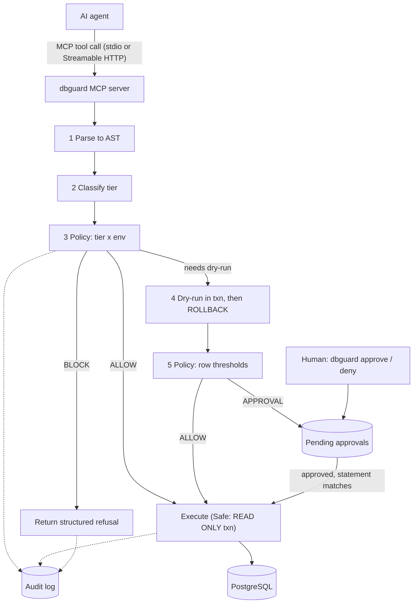

# dbguard

**A safety layer between AI coding agents and your database.**

> **Status: pre-alpha — scaffolding only. Nothing runs yet.** Progress is tracked in [ROADMAP.md](ROADMAP.md).

dbguard will sit in front of PostgreSQL as an [MCP](https://modelcontextprotocol.io) server. Your AI coding agent talks to dbguard instead of to the database. dbguard parses each SQL statement, classifies its risk, and then allows it, dry-runs it, holds it for your approval, or blocks it. Every decision is written to an audit log.

## Why

Agents act with a developer's credentials but without a developer's hesitation. Without a checkpoint, a `DROP TABLE` looks the same as a `SELECT`; "production" looks the same as "dev"; and nothing records what was asked versus what ran. See [MISSION.md](MISSION.md) for the full problem statement and scope.

## How it will work



### Risk tiers (draft — finalised in T-006 / T-007)

| Tier | Examples | Default: development | Default: production |
|---|---|---|---|
| Safe | `SELECT`, `SHOW`, `EXPLAIN` (no `ANALYZE`) | Allow (read-only transaction) | Allow (read-only transaction) |
| Caution | `INSERT`; `UPDATE`/`DELETE` with a real `WHERE`; `ADD COLUMN`; `CREATE TABLE` | Allow if dry-run rows are within the threshold, else approval | Approval |
| Destructive | `DROP`, `TRUNCATE`, `DELETE`/`UPDATE` with no effective `WHERE`, `DROP COLUMN` | Approval | Elevated approval |
| Blocked | `DROP DATABASE`, `ALTER SYSTEM`, `COPY … PROGRAM`, unparsable input | Block | Block |

## MVP scope

PostgreSQL only · MCP server (stdio for local use, Streamable HTTP for production) · AST-based classification · environment guard · transactional dry-run · CLI approvals bound to the exact statement · SQLite audit log · single self-hosted binary. Everything else is in the [ROADMAP](ROADMAP.md) Parking lot.

## Known limits

- dbguard only protects the path that goes **through** it. An agent that also holds a raw DSN or can run `psql` can bypass it.
- It does not guard infrastructure-API tokens (cloud/PaaS credentials).
- It complements, and does not replace, least-privilege database roles.
- In HTTP mode it is a network service holding database credentials: deploy it behind authentication, TLS, and restricted network access.

## Project documents

| File | Purpose |
|---|---|
| [MISSION.md](MISSION.md) | Why, scope, principles, non-goals, success criteria |
| [TECH_STACK.md](TECH_STACK.md) | Stack, architecture, decision register, verified facts |
| [ROADMAP.md](ROADMAP.md) | Milestones and small, approvable tasks |
| [SKILLS.md](SKILLS.md) | Go standards, Postgres/MCP knowledge, authoring and review checklists |
| [CLAUDE.md](CLAUDE.md) / [GEMINI.md](GEMINI.md) | Agent operating contract (identical rules) |
| `features/` | One folder per task: `requirements.md`, `plan.md`, `validation.md` |

## How we build

Spec-driven and human-gated. For every task, the agent drafts requirements, plan, and validation docs; the **human approves before any code is written**; the agent implements and verifies; the **human reviews and commits**. The anthem: *always be deterministic, and take human approval or decisions to accomplish that determinism.* Details in [CLAUDE.md](CLAUDE.md).

## Repository layout (current)

```
dbguard/
├── CLAUDE.md  GEMINI.md          agent contracts
├── MISSION.md  TECH_STACK.md  ROADMAP.md  SKILLS.md  README.md
├── .gitignore
└── features/
    └── _templates/               plan.md · requirements.md · validation.md
```

The Go module and source tree are created in T-001. The planned package layout is in `TECH_STACK.md` §4.

## Development

Not buildable yet. Planned prerequisites: Go 1.27 (D-012), `make`, and `golangci-lint` v2 (T-001); Docker for the throwaway Postgres used by integration tests (T-015). After T-001 the commands will be `make build` and `make check`.

## License

Not yet chosen (D-026, to be decided before the first public release in T-017).

## Maintainer

Vikash
