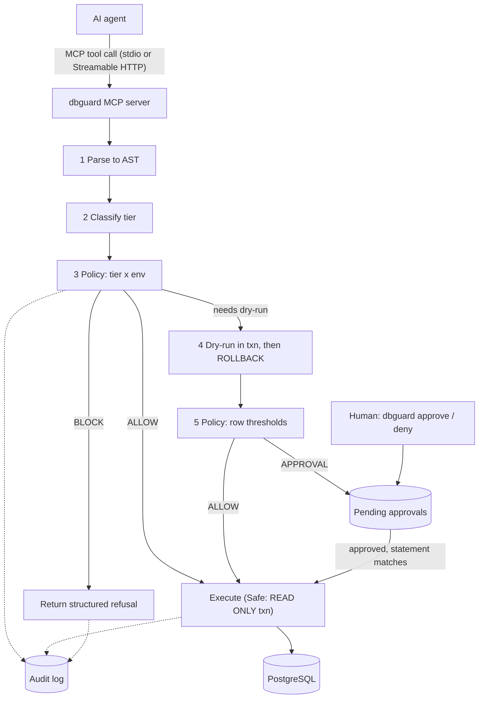

# TECH_STACK — dbguard

> **ALWAYS BE DETERMINISTIC. Human approval resolves every decision.**

Status: living document · Last updated: 2026-10-22

**How to read this file.** Every decision has an ID (`D-xxx`) in the register (§11) with a status:

- **Approved** — human-approved, binding.
- **Proposed** — agent recommendation, not binding.
- **Open** — needs a decision at the named task.

Nothing marked Proposed or Open may be encoded in code until it is Approved.

## 1. Stack at a glance

| Layer | Choice | Status | Decision |
|---|---|---|---|
| Language | Go, idiomatic, Go coding standards | Approved | D-003 |
| Target database (MVP) | PostgreSQL only | Approved | D-004 |
| Agent integration | MCP server, official Go SDK; stdio (local development and testing) and Streamable HTTP (production MVP) | Approved | D-005 |
| SQL analysis | AST parsing, never regex; library not yet chosen | Approved (approach), Open (library) | D-006, D-010 |
| Audit and approvals store | SQLite; driver not yet chosen | Approved (store), Open (driver) | D-007, D-011 |
| Approval UX (v0) | CLI | Approved | D-008 |
| Distribution | Self-hosted single binary (static only if D-010 allows) | Approved | D-009 |
| Postgres driver | `jackc/pgx` v5 | Proposed | D-013 |
| Config format | YAML with strict decoding | Proposed | D-014 |
| Logging | stdlib `log/slog`; stdout reserved for the MCP protocol | Proposed | D-016 |
| Tests | stdlib `testing`, table-driven, golden files, fuzz; docker-compose Postgres for integration | Proposed | D-019 |

## 2. Design principles (from MISSION §5, applied to design)

1. **Pure core, I/O at the edges.** `classify` and `policy` do no I/O, so they are exhaustively testable and deterministic.
2. **Fail closed everywhere.** Unparsable means Blocked. Unknown statement type means Destructive. Invalid config means refuse to start.
3. **Defence in depth.** Never rely on the parser alone: Safe-tier statements also run inside a `READ ONLY` transaction (D-020).
4. **One orchestrator.** Only `pipeline` sequences steps. Interfaces are defined where consumed, so each step is testable with fakes.
5. **Injected time and IDs.** No hidden clocks or randomness in decision logic.

## 3. Architecture



### Data flow for one request

1. The agent calls an MCP tool with a SQL string and a connection id, over stdio (local) or over authenticated Streamable HTTP (production).
2. `pipeline` asks `sqlparse` for statements. Parse failure results in **Blocked**.
3. `classify` assigns a tier per statement (§5). Multiple statements are handled per D-021.
4. `policy` (static stage) maps tier and environment to BLOCK / ALLOW / APPROVAL / needs dry-run.
5. If a dry-run is needed, `dryrun` runs the statement in a transaction and rolls back, returning rows affected. `policy` (threshold stage) then decides ALLOW or APPROVAL.
6. APPROVAL creates a pending record and returns a structured "approval required" result immediately (no blocking wait; see §7).
7. When the human approves, the agent re-submits the identical statement; `approval` matches it by binding, and execution proceeds once.
8. Every step's outcome is appended to the audit log.

### Trust boundaries

- **Agent**: untrusted input. Never receives a DSN, an approval secret, or raw error text that leaks credentials.
- **Network clients (HTTP mode)**: untrusted until authenticated (D-031). The endpoint binds to loopback by default, validates `Host` and `Origin`, and refuses unsafe configurations (D-032).
- **dbguard process**: trusted. Holds credentials (read from the environment).
- **Human CLI**: trusted. The only way to approve or deny.
- **PostgreSQL**: the protected asset.

## 4. Proposed package layout (Proposed — created in T-001 and the tasks after it; NOT created yet)

```
dbguard/
├── cmd/dbguard/        CLI entrypoint: serve, pending, show, approve, deny, log, version
├── internal/
│   ├── config/         config model, loading, validation (fail closed)
│   ├── sqlparse/       parser wrapper to an internal Statement model
│   ├── classify/       risk tiering rules (pure)
│   ├── policy/         (tier, env, thresholds) to decision (pure)
│   ├── pgexec/         connection registry, execution, READ ONLY handling
│   ├── dryrun/         transactional dry-run executor
│   ├── approval/       pending approvals, binding, TTL, state machine
│   ├── audit/          SQLite audit log
│   ├── pipeline/       orchestrates the whole flow
│   ├── version/        build version (set via -ldflags; added in T-001)
│   └── mcpserver/      MCP tool wiring and transports (stdio, Streamable HTTP); no business logic
├── testdata/           golden SQL corpus, incident scenarios
├── deploy/             docker-compose for the throwaway test Postgres
└── features/           per-task requirements, plan, validation
```

## 5. Classification and policy — v0 DRAFT (finalised in T-006 and T-007; needs human approval)

### Tiers

| Tier | Statement classes (draft) |
|---|---|
| **Safe** | `SELECT` with no locking clause, no `INTO`, and no data-modifying CTE; `SHOW`; `VALUES`; `EXPLAIN` without `ANALYZE` |
| **Caution** | `INSERT`; `UPDATE`/`DELETE` with an *effective* `WHERE`; `SELECT … FOR UPDATE/SHARE`; `CREATE TABLE`; non-concurrent `CREATE INDEX`; `ALTER TABLE … ADD COLUMN`; `COMMENT`; data-modifying CTEs (classified by the writing statement inside) |
| **Destructive** | `DROP` (any object except DATABASE); `TRUNCATE`; `DELETE`/`UPDATE` with no effective `WHERE`; `ALTER TABLE … DROP COLUMN / ALTER COLUMN TYPE / RENAME`; `GRANT`/`REVOKE`/role DDL; `DO`; `CALL`; `CREATE/ALTER` of functions, procedures, triggers, extensions; `LOCK`; anything that cannot run in a transaction block (`VACUUM`, `CREATE INDEX CONCURRENTLY`, `REINDEX`, `CLUSTER`); **any statement type not listed** |
| **Blocked** | `DROP DATABASE`; `ALTER SYSTEM`; `COPY … PROGRAM`; `SET ROLE` / `SET SESSION AUTHORIZATION`; `SET` / `RESET` of session configuration; `PREPARE` / `EXECUTE` (the executed text cannot be classified statically); **unparsable input** |

### Rules that need special care (each becomes a requirement and golden-corpus case in T-006)

- **Effective WHERE.** A constant-true predicate (`WHERE true`, `WHERE 1=1`) counts as *no* WHERE.
- **`EXPLAIN ANALYZE` executes the statement.** Classify by the inner statement and never lower than Caution.
- **Data-modifying CTEs.** `WITH d AS (DELETE … RETURNING *) SELECT …` is a top-level `SELECT` that deletes; the classifier must walk the tree.
- **`SELECT` can call side-effecting functions.** Do not trust the tier alone; defence in depth via D-020.
- **Unknown fails closed.** Parser success but unlisted statement type means Destructive.

### Policy matrix — draft defaults (D-023)

| Tier | development | production |
|---|---|---|
| Safe | ALLOW | ALLOW |
| Caution | ALLOW if dry-run rows ≤ `max_auto_rows` (default 1000); else APPROVAL | APPROVAL (`max_auto_rows` default 0; configurable) |
| Destructive | APPROVAL | APPROVAL-ELEVATED |
| Blocked | BLOCK | BLOCK |

**APPROVAL-ELEVATED** = standard approval plus a typed confirmation of the environment name, an explicit irreversibility acknowledgement, and a shorter TTL.

## 6. Dry-run semantics and known limits (D-024, finalised in T-010)

- **Mechanism (DML only in the MVP):** `BEGIN; SET LOCAL statement_timeout, lock_timeout; <statement>; read the command tag for rows affected; ROLLBACK`.
- **DDL gets static review only** (statement text, tier, environment). Running `DROP`/`ALTER` inside a transaction takes heavy locks and is not a safe preview on production.
- **Known limits to document, not hide:**
  - Sequences advance (`nextval` is not rolled back).
  - Triggers and volatile functions run inside the transaction; side effects outside Postgres (foreign data wrappers, `dblink`, untrusted-language functions) are not undone.
  - Statements that cannot run in a transaction block cannot be dry-run. Per §5 they are Destructive or Blocked.
  - A dry-run takes locks and can contend with production traffic; hence `lock_timeout`.
  - Row counts can differ between dry-run and real execution. Proposed mitigation (D-024): at execution time re-run inside a transaction and abort if the count differs from the approved estimate beyond a configured tolerance.

## 7. Approval model (D-022, finalised in T-011)

- **Binding:** an approval is bound to `(SHA-256 of the exact statement text, connection id, environment, tier)`. It has a TTL (draft default 15 minutes; shorter for ELEVATED), and is **one-time use**.
- **Do not use pg_query's fingerprint for binding.** It deliberately ignores literal values, so `id = 1` and `id = 2` would share one approval.
- **States:** `pending` → `approved` / `denied` / `expired` → `consumed`.
- **No blocking waits.** MCP clients reportedly enforce tool-call timeouts (about 60 s in some clients, per practitioner reports; verify in T-002). The tool returns `approval_required` plus an id immediately; after approval, the agent re-submits the same statement and dbguard matches it by binding.
- **Cross-process:** the MCP server process and the CLI process share the SQLite file (WAL mode, `busy_timeout`).

## 8. Audit log (D-029, finalised in T-008)

Append-only, one row per request: id, UTC timestamp (injected clock), agent/session id if supplied, connection id, environment, statement text (policy per D-029), tier, decision, matched rule ids, dry-run rows, executed (bool), rows affected, error class, latency, approval id, approver (OS user). Append-only is enforced by schema (triggers that reject `UPDATE`/`DELETE`). Tamper-evident hash chaining is a Parking-lot item.

## 9. Threat model (summary — expanded in T-016)

| In scope | Out of scope (stated in README) |
|---|---|
| Accidental destructive SQL from an agent through dbguard | An agent that bypasses dbguard (raw DSN, `psql`, another DB tool) |
| Wrong-environment targeting | Infrastructure-API / cloud-token abuse |
| Unaudited changes | A malicious human with database credentials |
| Approval replay or swap (approve X, run Y) | Prompt-injection detection (Parking lot) |
| Credential leakage to the agent or to logs | Side effects outside Postgres during dry-run (documented limit) |
| Unauthenticated, cross-origin, or DNS-rebinding access to the HTTP endpoint | Compromise of the host running dbguard; TLS misconfiguration outside dbguard |

## 10. Conventions (Proposed; set in T-001)

- **Go version / module path:** Go 1.27 (D-012, Approved); module path `github.com/<handle>/dbguard` (D-030, GitHub handle pending).
- **Format / lint:** golangci-lint v2 with formatters gofmt and goimports, the `standard` linter set plus `errorlint`, `gochecknoinits`, `gochecknoglobals`, and `go vet`; committed `.golangci.yml` (D-017, Proposed; approved at T-001).
- **Logging:** `log/slog` to stderr or a file in every mode; **in stdio mode stdout is reserved for the MCP protocol** (D-016).
- **Errors:** wrap with `%w`; sentinel/typed errors for decision-relevant failures.
- **Tests:** table-driven; golden files in `testdata/`; Go native fuzzing for `classify`; integration tests behind `//go:build integration`; Postgres only via docker-compose on localhost (D-019).
- **Commits:** Conventional Commits; the human commits (D-018).

## 11. Decision register

| ID | Decision | Status | Resolve at | Notes / recommendation |
|---|---|---|---|---|
| D-001 | Project and folder name `dbguard`; local path `/Users/vikash/projects/dbguard` | **Approved** 2026-10-22 | n/a | |
| D-002 | Spec-driven workflow with human gates; human commits; `CLAUDE.md` and `GEMINI.md` agent contracts | **Approved** 2026-10-22 | n/a | See CLAUDE.md |
| D-003 | Language: Go, idiomatic, Go coding standards | **Approved** 2026-10-22 | n/a | |
| D-004 | MVP database: PostgreSQL only | **Approved** 2026-10-22 | n/a | |
| D-005 | Integration surface: MCP server using the official Go SDK (`github.com/modelcontextprotocol/go-sdk`). Transports: **stdio** for local development and testing; **Streamable HTTP** for the production MVP (both supported) | **Approved** 2026-10-22 (transports amended per human review comment) | pin version at T-002 | See §12. HTTP security: D-031, D-032 |
| D-006 | SQL analysis by AST parsing, never regex | **Approved** 2026-10-22 | n/a | Library: D-010 |
| D-007 | Audit and approvals stored in SQLite | **Approved** 2026-10-22 | n/a | Driver: D-011 |
| D-008 | Approval UX v0 is the CLI | **Approved** 2026-10-22 | n/a | |
| D-009 | Distribution: self-hosted single binary | **Approved** 2026-10-22 | n/a | "Static" depends on D-010 |
| D-010 | Parser library and CGo posture | **Open** | T-003 | Candidates: `pganalyze/pg_query_go` (cgo), `wasilibs/go-pgquery` (WASM, no cgo), `sqlc-dev/oliphant` (pure Go, v0.1.0). **Reopened:** the earlier recommendation of `pg_query_go` plus a pure-Go SQLite driver was inconsistent about cgo. Criteria: parse fidelity on a conformance corpus, maintenance, `CGO_ENABLED=0` / cross-compile story, latency. Human agreed (2026-10-22) to resolve this by the T-003 spike |
| D-011 | SQLite driver | **Open** | T-003 (together with D-010) | `modernc.org/sqlite` (pure Go) or `mattn/go-sqlite3` (cgo). Recommend modernc if D-010 lands on a no-cgo parser |
| D-012 | Go language version | **Approved** 2026-10-22 | T-001 (applied in `go.mod`) | Human-stated: Go 1.27. Not independently verified by the agent; `go version` is the evidence |
| D-013 | Postgres driver | Proposed | T-009 | `jackc/pgx` v5 (`pgxpool`) |
| D-014 | Config format | Proposed | T-004 | YAML with strict decoding (reject unknown fields); alternative TOML |
| D-015 | CLI framework | Open | T-014 | Recommend stdlib `flag` plus a small dispatcher while there are 7 or fewer subcommands; alternative cobra |
| D-016 | Logging | Proposed | T-001 | stdlib `log/slog`; logs go to stderr or a file, never stdout (stdout is reserved for the MCP protocol in stdio mode) |
| D-017 | Lint and format toolchain | Proposed | T-001 | gofmt, goimports, go vet, golangci-lint |
| D-018 | Commit convention | Proposed | T-001 | Conventional Commits |
| D-019 | Test strategy | Proposed | T-001 (conventions), T-015 (suite) | stdlib `testing`, table-driven, `go-cmp` for diffs, `integration` build tag, docker-compose Postgres on localhost |
| D-020 | Safe tier executes inside a `READ ONLY` transaction | Proposed | T-009 | Recommend yes: engine-level backstop for parser misses. Not absolute (see SKILLS §4) |
| D-021 | Multi-statement requests | Open | T-005 | A) reject in the MVP ("one statement per call"); B) classify each, overall = max tier, approval binds to the whole batch. Recommend A: removes a bypass class and keeps approvals exact |
| D-022 | Approval binding model | Proposed | T-011 | See §7 |
| D-023 | Policy defaults | Proposed | T-007 | See §5 |
| D-024 | Dry-run scope and execute-time re-validation | Proposed | T-010 | See §6 |
| D-025 | MCP tool names, annotations, response shape | Open | T-013 | Draft names `dbguard_query`, `dbguard_execute`. Annotations are hints only and are never relied on for enforcement |
| D-026 | License | Open | T-017 | Permissive (MIT / Apache-2.0) versus protective options. Not legal advice; decide before the first public release |
| D-027 | CI provider | Open | T-017 | Depends on where the repository is hosted |
| D-028 | Performance budget | Proposed | T-012 | p95 overhead under 20 ms on the Safe path, excluding DB time |
| D-029 | Audit statement-text storage and literal redaction | Open | T-008 | A) full text locally by default; B) hash only; C) configurable redaction. Recommend A now, C later |
| D-030 | Go module path | **Open** | T-001 | Human approved the pattern `github.com/<handle>/dbguard` on 2026-10-22; the GitHub handle or org is still needed |
| D-031 | HTTP authentication mechanism and caller identity | **Open** | T-020 (informed by T-002) | A) static bearer token per agent identity, read from a named environment variable, constant-time comparison, identity written to the audit log; B) OAuth 2.1 per the MCP authorization spec (heavier); C) proxy-asserted identity header (safe only behind a trusted proxy). Recommend A for the MVP; confirm in T-002 that Claude Code and Gemini/Antigravity can send a custom `Authorization` header (reported, unverified) |
| D-032 | HTTP deployment posture | **Open** | T-020 | Recommend: bind `127.0.0.1` by default; refuse a non-loopback bind unless it is explicitly configured **and** authentication is configured; validate `Host` and `Origin` against allowlists; TLS terminated by a reverse proxy (built-in TLS is Parking lot); request-size limits; graceful shutdown. Fail closed on any missing setting |

## 12. Verified facts log (re-verify at the task shown; do not treat as permanent)

| Date | Fact | Source | Re-verify at |
|---|---|---|---|
| 2026-10-22 | Official Go MCP SDK: `github.com/modelcontextprotocol/go-sdk`, maintained in collaboration with Google. v1.7.0 (published 2026-07-27) supports MCP spec 2026-07-28 and earlier versions | pkg.go.dev and the SDK README | T-002 |
| 2026-10-22 | MCP spec 2026-07-28 deprecates the `roots`, `sampling`, and `logging` features (SEP-2577); the SDK keeps supporting them for at least 12 months | SDK README | T-002 |
| 2026-10-22 | `pganalyze/pg_query_go` invokes `libpg_query` through cgo | `wasilibs/go-pgquery` README (pkg.go.dev) | T-003 |
| 2026-10-22 | `wasilibs/go-pgquery` is a drop-in replacement that compiles the C library to WebAssembly and runs it on the pure-Go `wazero` runtime (no cgo needed; cgo opt-in via build tag `pgquery_cgo`). The pkg.go.dev listing showed an April 2025 publish date, so maintenance status must be checked | pkg.go.dev | T-003 |
| 2026-10-22 | `sqlc-dev/oliphant` v0.1.0 is described as a pure-Go drop-in replacement for `pg_query_go` tracking `libpg_query` 18; sqlc adopted it in PR #4561. Maturity is unknown | GitHub (sqlc PR #4561) | T-003 |
| 2026-10-22 | Go SDK transports, from secondary sources (pkg.go.dev listings, SDK pull requests, third-party docs): stdio via `server.Run(ctx, &mcp.StdioTransport{})`; HTTP via `mcp.NewStreamableHTTPHandler(getServer, opts)` returning an `http.Handler`, with options such as `EventStore`, `SessionStateStore`, `SessionTimeout`, `JSONResponse`, `Logger`. Exact v1.7.0 signatures and stateless behaviour are not yet confirmed | pkg.go.dev, SDK pull requests, third-party docs | T-002 |
| 2026-10-22 | MCP transport security guidance (spec 2025-06-18, Streamable HTTP): servers MUST validate the `Origin` header on all connections (DNS rebinding); locally run servers SHOULD bind to `127.0.0.1`, not `0.0.0.0`; servers SHOULD implement authentication for all connections. Not yet re-checked against spec 2026-07-28 | modelcontextprotocol.io transports docs, spec repository | T-020 |
| 2026-10-22 | CVE-2026-42559: the Rust `rmcp` Streamable HTTP server (before 1.4.0) did not validate the `Host` header, so a malicious website could use DNS rebinding to send authenticated requests to a loopback MCP server; fixed by Host validation with a loopback-only default allowlist. The risk class is current | vuln.today (CVE-2026-42559) | T-020 |
| 2026-10-22 | Third-party Go MCP projects front the SDK's HTTP handler with a reverse proxy (TLS, auth, rate limiting). **Not verified:** whether the Go SDK handler itself validates `Origin`/`Host` or authenticates. Do not assume it does | third-party docs (secondary) | T-002, T-020 |
| 2026-10-22 | golangci-lint v2: config file `.golangci.yml` with `version: "2"`; `linters.default` accepts `standard`, `all`, `none`; formatters (`gofmt`, `goimports`, and others) are enabled under `formatters.enable`; `golangci-lint fmt` formats and `golangci-lint fmt --diff` exits non-zero when code is not formatted; enabled formatters also run under `golangci-lint run` | golangci-lint.run docs, secondary articles | T-001 |
| 2026-10-22 | Go language version for the project is 1.27, as stated by the human; not independently verified by the agent | Human | T-001 |

## 13. Dependency register

| Module | Purpose | Status |
|---|---|---|
| `github.com/modelcontextprotocol/go-sdk` | MCP server | Approved (D-005); version pinned at T-002 |
| SQL parser (see D-010) | AST parsing | Open |
| SQLite driver (see D-011) | Audit and approvals | Open |
| `github.com/jackc/pgx/v5` | Postgres access | Proposed (D-013) |
| YAML library | Config | Open (D-014) |
| `github.com/google/go-cmp` | Test diffs (test-only) | Proposed (D-019) |
