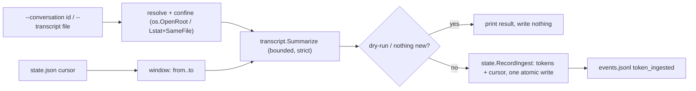

# Plan — T-064 Native IDE transcript discovery and ingestion in sdd record-tokens

> ALWAYS BE DETERMINISTIC. Human approval resolves every decision.

Status: Approved (2026-11-26)
Roadmap ref: `ROADMAP.md` T-064

## 1. Approach summary
Add a small `internal/transcript` package (pure parsing plus strict source resolution) and extend `sdd record-tokens` to feed its summed delta into the existing token accumulator. To make re-runs safe, `internal/state` gains one atomic operation that updates `tokens` and a per-source cursor in the same `state.json` write. The manual flags keep working unchanged. No template, contract, or skill file changes, so no `templates.Version` bump is needed. Scope is Antigravity only; other formats are unverified and parked.

## 2. Decisions (new or affected)

| ID | Decision | Options | Recommendation | Status |
|---|---|---|---|---|
| D-050 | Token consumption mitigation, context hygiene, provider caching (native transcript telemetry is its last item) | A) as approved | A | Approved (2026-11-25) |
| D-051 | Transcript source and trust boundary | A) explicit path only B) path or conversation ID under a documented root, no scanning C) scan for newest | B | Approved (2026-11-26, human chose B) |
| D-052 | Task attribution and idempotency | A) `--from-step/--to-step` plus per-task cursor B) time window C) whole transcript | A | Approved (2026-11-26, human chose A) |
| D-053 | Counted records and subagents | A) MODEL/PLANNER_RESPONSE only; subagents one run each via `--conversation` + `--role` B) also CHECKPOINT C) auto-discover subagents | A | Approved (2026-11-26, human chose A) |

All three rows (`D-051`..`D-053`) are recorded as `Approved` in `TECH_STACK.md` §6.

## 3. Design

### `internal/transcript` (new)
```go
const (
    DefaultMaxBytes     int64 = 256 << 20
    DefaultMaxLineBytes       = 1 << 20
    NoLimit                   = -1
)

type Options struct {
    FromStep, ToStep int   // ToStep == NoLimit means open-ended; FromStep < 0 or ToStep < NoLimit rejected
    MaxBytes         int64 // 0 => DefaultMaxBytes
    MaxLineBytes     int   // 0 => DefaultMaxLineBytes
}
type Summary struct {
    Input, CacheRead, Output int64
    Steps, SkippedNoUsage    int
    LastStepSeen             int // highest step_index of ANY record; -1 if none
}
func Summarize(r io.Reader, opts Options) (Summary, error)

func ValidateConversationID(id string) error                   // strict lowercase 8-4-4-4-12 hex
func OpenConversation(rootDir, id string) (io.ReadCloser, error) // os.OpenRoot(rootDir); open <id>/.system_generated/logs/transcript.jsonl; regular file only
func OpenFile(path string) (io.ReadCloser, error)                // Lstat regular -> Open -> f.Stat + os.SameFile + Mode().IsRegular()
func SourceKeyForPath(absPath string) string                     // "file:" + 16 hex of sha256(Clean(abs))
func DefaultRoot(home string) (string, error)                    // error if strings.TrimSpace(home)==""
```
Only the six fields (`step_index *int`, `source string`, `type string`, `input_tokens *int64`, `cache_read_tokens *int64`, `output_tokens *int64`) are decoded via an unexported struct. Parsing rules:
- `step_index` is required (`!= nil`) and `>= 0` on every record.
- Any non-nil decoded token pointer (`input_tokens`, `cache_read_tokens`, `output_tokens`) with value `< 0` fails on **any** line (even out-of-window or non-`MODEL` records).
- For `source == "MODEL" && type == "PLANNER_RESPONSE"` inside `[FromStep, ToStep]`: if all three token pointers are `nil`, increment `SkippedNoUsage`; if only some are `nil`, return an error (partial usage); otherwise overflow-safe add to `Input`/`CacheRead`/`Output` and increment `Steps`.
- Any JSON/type/bounds error is formatted strictly as `line %d: <reason>` so raw transcript text never appears in errors.

### `internal/state` (modify)
```go
type Ingest struct {
    Source, Role            string
    FromStep, ToStep, Steps int
    Delta                   TokenTelemetry
}
func CursorFor(stateMap map[string]any, source string) (lastStep int, role string, ok bool)
func RecordIngest(root, taskID string, ing Ingest, now time.Time) (SaveResult, TokenTelemetry, error)
```
`RecordTokens` and `RecordIngest` share an unexported accumulation helper that recomputes `TotalTokens` with int64 overflow checks (never trusting caller `Delta.TotalTokens`). `RecordIngest` validates `Source != ""`, `Role != ""`, `FromStep >= 0`, `ToStep >= FromStep`, `Steps > 0`, validates any existing `state["ingest"]` structure (failing if malformed rather than silently overwriting), re-checks the cursor inside the write (rejects `FromStep <= cursor` or role mismatch), sets `state["ingest"][source] = {"last_step": ing.ToStep, "role": ing.Role}`, saves once atomically, then appends the `token_ingested` event:
```json
{"type":"token_ingested","task_id":"T-xxx","source":"<key>","role":"<role>","from_step":10,"to_step":20,"steps":5,"delta":{"input":...,"cache":...,"output":...},"totals":{...},"recorded_at":"RFC3339"}
```

### `internal/cli` (modify + new file)
`doRecordTokens` tracks explicitly set flags via `fs.Visit`:
- Exclusivity & usage (exit 2): `--conversation` and `--transcript` are mutually exclusive and mutually exclusive with `--input`/`--cache`/`--output`/`--stdin`; `--transcript-root` requires `--conversation`; `--from-step`/`--to-step`/`--role`/`--dry-run` require `--conversation` or `--transcript` (bare `sdd record-tokens T-xxx` with zero flags retains legacy manual behavior with 0 delta); invalid `--role` (`^[a-z][a-z0-9-]{0,39}$`) exits 2; negative `--from-step` or `--to-step` exits 2 (never collides with `NoLimit = -1`).
- Window & cursor: first ingestion of `source` requires `--from-step`; later ingestions default `--from-step` to `cursor+1`. Reject `fromStep <= cursor`, `toStep >= 0 && fromStep > toStep`, or role mismatch (exit 1).
- Effective window & nothing-new: `effectiveTo = min(requestedTo, sum.LastStepSeen)` (or `sum.LastStepSeen` when `ToStep == NoLimit`). If `sum.Steps == 0`, report `"nothing new"`, write nothing, exit 0.
- `--json` (for both real and `--dry-run`) prints `TranscriptIngestResult`:
  `{task_id, source, role, from_step, to_step, steps, skipped_no_usage, last_step_seen, dry_run, nothing_new, saved, path?, updated_at?, delta, totals}` (on `--dry-run`, `totals` reports the overflow-checked projected `existing + delta`).

### Data flow


## 4. Implementation steps

| # | Step | Files | Proving test / check |
|---|---|---|---|
| 1 | Refactor `RecordTokens` onto a shared accumulate helper; add `Ingest`, `CursorFor`, `RecordIngest` with in-write cursor/role re-check and `token_ingested` event | `internal/state/state.go`, `internal/state/state_test.go` | `go test -v ./internal/state -run TestRecordIngest` |
| 2 | Implement `Summarize` with window, strictness, bounds, no-content-leak, plus unit tests & `BenchmarkSummarize` | `internal/transcript/transcript.go`, `internal/transcript/transcript_test.go` | `go test -v ./internal/transcript -run TestSummarize` |
| 3 | Implement `ValidateConversationID`, `OpenConversation`, `OpenFile`, `SourceKeyForPath`, `DefaultRoot`, plus unit tests | `internal/transcript/source.go`, `internal/transcript/source_test.go` | `go test -v ./internal/transcript -run TestSource` |
| 4 | Wire CLI flags, exclusivity, window/cursor logic, dry-run, JSON output, and role validation | `internal/cli/transcript_ingest.go`, `internal/cli/task_state.go` | `make build` |
| 5 | Update top-level `record-tokens` help line and write CLI end-to-end tests + manual path regression checks | `internal/cli/cli.go`, `internal/cli/transcript_ingest_test.go` | `go test -v ./internal/cli -run TestTranscriptIngest` |
| 6 | Update living docs: architecture/roadmap (`TECH_STACK.md`, `ROADMAP.md`) and user/agent standards (`README.md`, `SKILLS.md`) | `TECH_STACK.md`, `ROADMAP.md`, `README.md`, `SKILLS.md` | `./bin/sdd check --strict` |
| 7 | Full verification: build, `make verify`, `-race`, `-count=2`, scoped `golangci-lint`, real-transcript cross-check & timing, dogfood `sdd record-tokens T-064` | `tasks/features/T-064-native-transcript-token-ingestion/validation.md` | `make verify` |

## 5. Files to create or modify

| Path | Action | Reason |
|---|---|---|
| `internal/transcript/transcript.go` | create | `Summarize`, `Options`, `Summary` |
| `internal/transcript/source.go` | create | ID validation, confined open, source keys, default root |
| `internal/transcript/transcript_test.go` | create | parser tests and `BenchmarkSummarize` |
| `internal/transcript/source_test.go` | create | source resolution tests |
| `internal/state/state.go` | modify | shared accumulate helper, `Ingest`, `CursorFor`, `RecordIngest` |
| `internal/state/state_test.go` | modify | ingest and cursor tests |
| `internal/cli/transcript_ingest.go` | create | transcript branch of `record-tokens` |
| `internal/cli/transcript_ingest_test.go` | create | CLI tests |
| `internal/cli/task_state.go` | modify | route to transcript ingestion; usage text |
| `internal/cli/cli.go` | modify | `record-tokens` help line |
| `README.md` | modify | usage and Antigravity-only scope |
| `SKILLS.md` | modify | new standard: transcript ingestion and coordinator workflow |
| `TECH_STACK.md` | modify | D-051..D-053, `internal/transcript` layout, verified fact |
| `ROADMAP.md` | modify | status, Outcome/Decisions update, change log, parking lot |
| `tasks/features/T-064-native-transcript-token-ingestion/requirements.md` | modify | task requirements |
| `tasks/features/T-064-native-transcript-token-ingestion/plan.md` | modify | task plan |
| `tasks/features/T-064-native-transcript-token-ingestion/validation.md` | modify | validation evidence |
| `tasks/features/T-064-native-transcript-token-ingestion/review.md` | modify | review ledger and sign-off |
| `.sdd/state/T-064/state.json` | create | task state and telemetry |
| `.sdd/state/T-064/events.jsonl` | create | task event journal |

No file under `internal/templates/`, no agent contract file, and no `skills/` file is touched.

## 6. Dependencies
None. Standard library only (`encoding/json`, `bufio`, `crypto/sha256`, `os` incl. `os.OpenRoot`, `io`, `regexp`, `path/filepath`).

## 7. Living docs to update

| File | Change |
|---|---|
| `ROADMAP.md` | T-064 status through `Done`; Outcome updated from `"Auto-discovery and JSONL parsing..."` to `"Explicit-source JSONL parsing of IDE conversation transcripts in sdd record-tokens..."`; Decisions updated to `D-050, D-051, D-052, D-053`; parking lot: (a) auto-fill `validation.md` §8 from ingestion, (b) coordinator skill/prompt guidance for `--conversation`, (c) other IDE transcript formats once verified |
| `TECH_STACK.md` | D-051..D-053 rows (already recorded); `internal/transcript/` in layout; verified-facts row (2026-11-26 transcript schema, Antigravity only). Qualify transcript path as `<id>/.system_generated/logs/transcript.jsonl` to satisfy `citation-hygiene`. |
| `SKILLS.md` | new standard "Native transcript token ingestion" (window, cursor, one run per subagent, never type estimates; qualify path as `<id>/.system_generated/logs/transcript.jsonl`) |
| `README.md` | `sdd record-tokens` transcript flags, Antigravity-only scope note, example (qualify path as `<id>/.system_generated/logs/transcript.jsonl`) |

## 8. Risks, mitigations, rollback
- Risk: transcript schema changes silently → Mitigation: strict parsing fails loudly on malformed, partial, or negative values; records lacking usage fields are counted in `SkippedNoUsage` and reported, never guessed; the schema is logged as a dated verified fact.
- Risk: the coordinator counts its own in-progress turn, so the last ingest is slightly short of "final" → Mitigation: documented; ingest again later (cursor makes it additive).
- Risk: wrong `--from-step` on first use drops or inflates early tokens → Mitigation: required flag, `--dry-run` preview, and `LastStepSeen` shown in output.
- Risk: concurrent runs race on `state.json` → Mitigation: unsupported and documented; cursor re-checked inside the atomic write.
- Risk: privacy → Mitigation: only six numeric/enum fields are decoded; nothing else is kept; no absolute paths persisted.
- Rollback: revert the task branch merge; `state.json` files written by ingestion only add an `ingest` key and larger `tokens`, which older binaries ignore.

## 9. Applicable human-feedback rules (SKILLS.md, "Human feedback rules")
- `F-001`: all review findings (Blockers, Warnings, Minors) resolved before GATE 2.
- `F-002`: no personal absolute paths in code, tests, docs, state, or output (enforced by R-005 and a test).
- `F-003`: token telemetry for T-064 itself is recorded with the new feature (dogfood), using measured values; any value that is an estimate must be labelled as such.

## 10. Approval record
Approved by: Vikash   Date: 2026-11-26   Phrase received: `APPROVED T-064`
